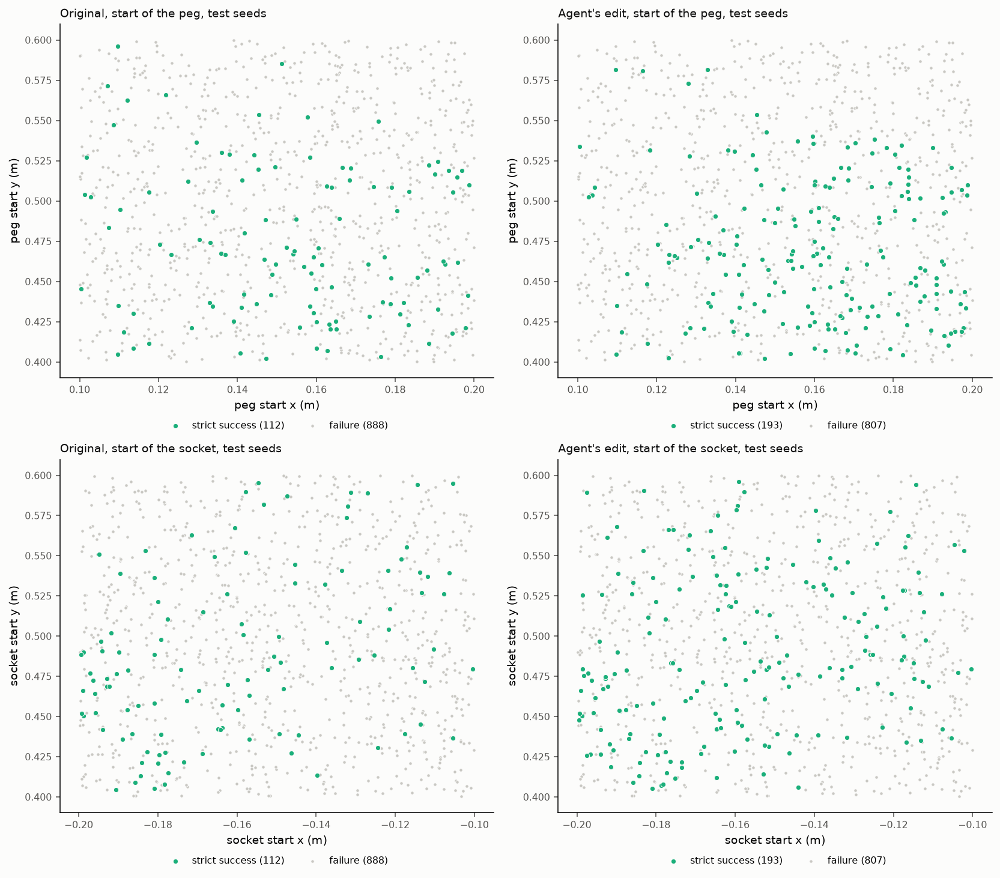
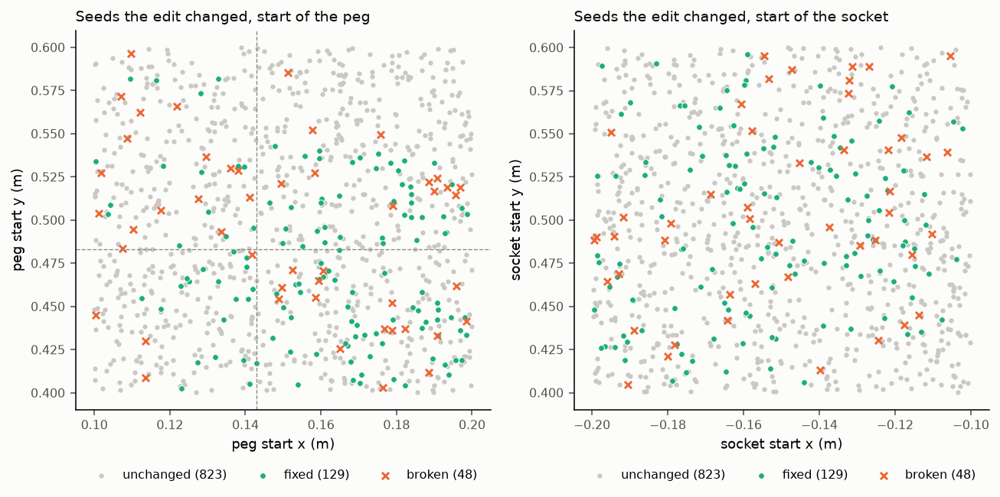
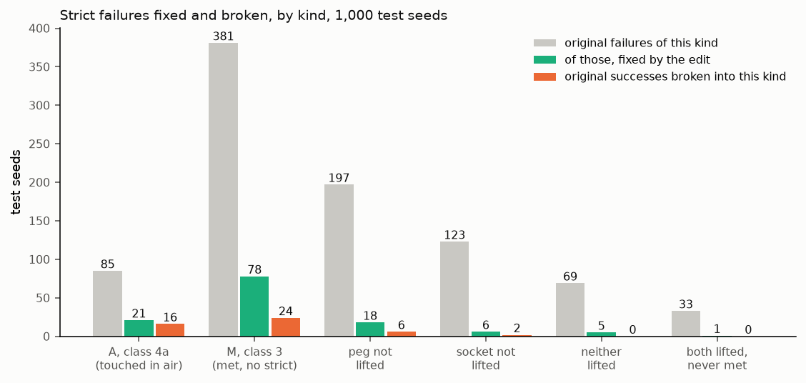
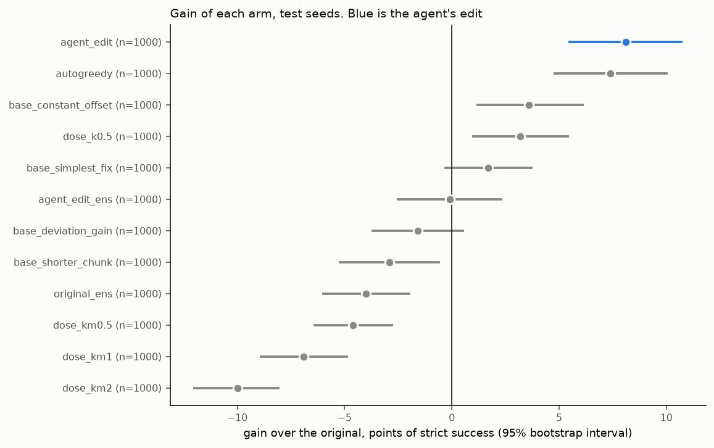
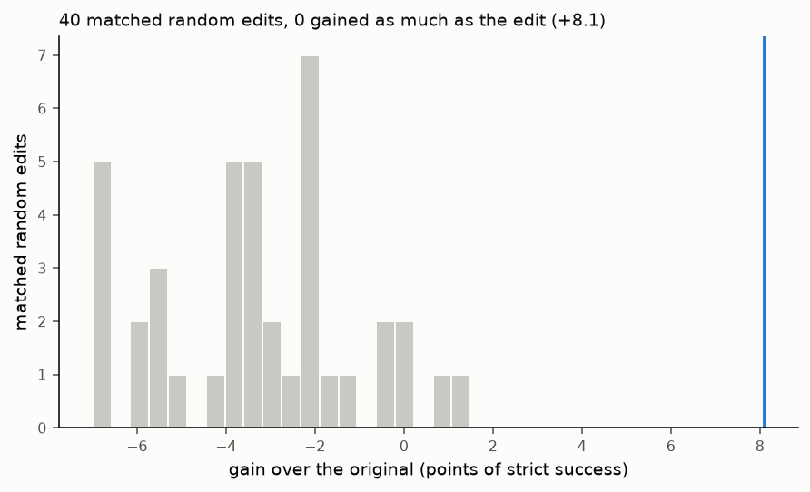
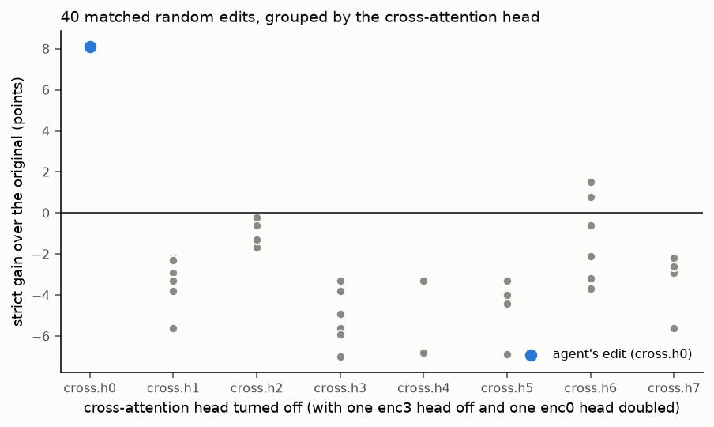
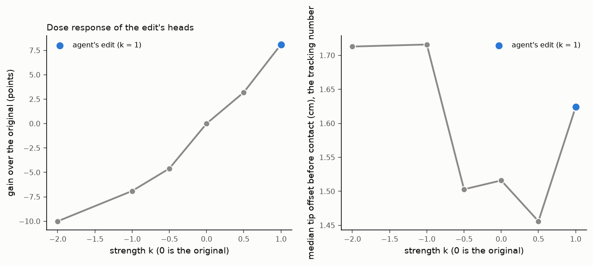

# Report, insertion

The referee's block below is copied unchanged from `test/VERDICT.md` and is final. The rest of this file describes the per-seed files behind it and decides nothing. Sections marked *descriptive* were computed after the test was read and carry no verdict. For this task the primary score is strict success (the peg held in the socket for 25 steps, `stage1/decisions.json`), and benchmark success (LeRobot's own score) is the guard.

{{VERDICT}}

## What happened, in short

Three attention heads were rescaled: decoder cross-attention head 0 off (x0), encoder layer 3 head 3 off (x0) and encoder layer 0 head 6 doubled (x2). That is 98,304 weights, 0.287% of the weights that run. On the 1,000 test seeds strict success rose from 11.2% to 19.3%: 129 seeds fixed and 48 broken. Benchmark success rose from 19.7% to 30.4%.

This edit was frozen under the **stop rule**. It missed the validation rule (25% of strict failures removed). On the 500 validation seeds it removed 8.6% of failures (+7.8 points, 63 fixed and 24 broken). The freeze package said so (`freeze/edit.json`, `stop_rule_used` true). The test gives the same picture. The gain is clear (p 9.3e-10), but the edit removes 9.1% of failures (95% interval 6.3% to 11.9%), far below 25%. That is why the ending is a modest win and not a strong one. Strict gains were +10.6 on design, +7.8 on validation and +8.1 on test, so the design number was optimistic and the validation number held up.

What this does not show:

1. **The third head adds nothing that can be measured.** The auto-greedy arm is the same edit without enc0.h6 x2 (cross.h0 x0, enc3.h3 x0). It is also the agent's own candidate c06, which the agent had seen before the search ran, so it is not an independent no-LLM result (DEVIATIONS.md, 2026-11-25, and `relation_to_agent_candidates` in `freeze/autogreedy.json`). On the test it gained +7.4. Paired with it on the same seeds, the edit leads by 0.7 points (95% interval -1.6 to +3.0, 70 seeds go to the edit and 63 to the two-head arm, p 0.6). On benchmark success the two-head arm is 0.1 points ahead. The verdict line "did not match" follows the referee's rule (a gain at least as large). The two arms cannot be told apart, and the effect belongs to the two heads that are turned off. The hypothesis line for r1 predicted this ("the third head is expected to add nothing").
2. **The tracking number written down for the mechanism went the wrong way.** The hypothesis was that the two heads slow the approach, and that turning them off lets the peg reach the pin earlier, so more contacts last the 25 steps strict needs. The tracking number fixed at Gate 1 is the median peg-tip offset just before the first contact. It rose from 1.516 cm to 1.624 cm (over 578 and 637 met episodes), as it did on validation (1.63 to 1.85). It also fails the dial test across the dose arms. So the mechanism the tracking number was meant to follow is not confirmed. The timing numbers named in the hypothesis do move the predicted way (next point and the dose section), but they were not the pre-set tracking number.
3. **The best simple baseline beats the original but falls short of the edit on the test.** The constant offset (+0.04 rad on joint 1) gained +3.6. On validation the edit could not be told apart from it (60 seeds against 45, p 0.17). On the test the edit leads it by 4.5 points (95% interval +1.6 to +7.3, 127 seeds against 82, p 0.0023, descriptive), and by 4.0 on benchmark success.

On timing (*descriptive*), the median step of the first peg-socket contact moved from 300 to 289 and the first pin contact from 338 to 330. Episodes that reach the pin rose from 197 to 304, and the share of pins starting at step 375 or later fell from 0.112 to 0.033. Of the episodes that reach the pin, 63% end strict under the edit, against 57% for the original. Most of the gain comes from more episodes reaching the pin at all, not from better insertion once there.

The claim is a significant gain on unseen seeds, in this one scene with this one checkpoint, that meets the rules for H2 (no random edit of the same shape gained as much) and H3 (no simple baseline gained as much). It removes under a tenth of the failures. Most failures are untouched, including nearly all of those where the objects are never lifted or never meet.

## Before and after maps

Green points in the first figure are strict successes, for the peg (top) and the socket (bottom). The second figure shows only the 177 seeds that changed. The gain is spread out, but on the peg map it is denser at larger x and smaller y. The dashed lines mark the zones below.

| zone (cutoffs set after the design results of the combinations, so post hoc) | n | original | edit | fixed | broke |
|---|---|---|---|---|---|
| peg x below 0.143 (larger tip offset), inside | 408 | 9.3% | 13.0% | 35 | 20 |
| peg x below 0.143, outside | 592 | 12.5% | 23.6% | 94 | 28 |
| peg y above 0.483 (larger tip offset), inside | 559 | 8.1% | 13.1% | 56 | 28 |
| peg y above 0.483, outside | 441 | 15.2% | 27.2% | 73 | 20 |

In Stage 1 the tip offset was larger in these two zones, and on the test the original is weaker there too. The edit helps there least. Inside each zone it gains about 4 to 5 points, outside each about 11 to 12. Validation showed the same thing (`freeze/analysis_validation/tables.md`). So the edit does not repair the weak zone the diagnosis pointed to. It mostly lifts placements where the original already did better.

## Fixed and broken by failure class

| class (the referee's classes) | original | edit |
|---|---|---|
| 0, highest stock reward 0 (the grippers never both touched their objects) | 172 | 143 |
| 1, both grippers touched, objects not both lifted | 199 | 191 |
| 2, both objects held off the table, never met | 51 | 29 |
| 3, peg met the socket off the table, never the pin | 381 | 333 |
| 4a, pin contact, not strict (benchmark success) | 85 | 111 |
| 4b, strict success | 112 | 193 |

The finer kinds of `freeze/analysis.py` split the failures before the objects meet (classes 0 to 2) by which object was not lifted. The table counts original strict failures of each kind and how many the edit fixed.

| kind | original failures | fixed | rate | original successes broken into this kind |
|---|---|---|---|---|
| A (class 4a) | 85 | 21 | 25% | 16 |
| M (class 3, the target class at Gate 1) | 381 | 78 | 20% | 24 |
| peg not lifted | 197 | 18 | 9% | 6 |
| socket not lifted | 123 | 6 | 5% | 2 |
| neither lifted | 69 | 5 | 7% | 0 |
| both lifted, never met | 33 | 1 | 3% | 0 |

The target class M shrank from 381 to 333, and 78 of its seeds became strict. Class 4a grew from 85 to 111 because many M seeds now reach the pin without finishing (55 seeds went from M to A). The peg-not-lifted kind grew a little (197 to 206). The edit fixes few of the failures before the objects meet (classes 0 to 2), and they are 422 of the 888 original failures. That alone caps how much of the failure rate a change after the grasp can remove. The edit also moved many seeds between failure kinds without fixing them. For example, 30 seeds went from M to peg-not-lifted and 18 from neither-lifted to peg-not-lifted (`extra.json`, `kind_transitions`). The policy's grasp is sensitive to these heads, in both directions.

## Gain of every arm, baselines side by side

| arm | strict success | gain (points) | 95% interval | fixed | broke | benchmark gain (points) | edit's paired lead (points) |
|---|---|---|---|---|---|---|---|
| agent's edit (r1) | 19.3% | +8.1 | +5.5 to +10.7 | 129 | 48 | +10.7 | |
| auto-greedy (= c06, the edit without enc0.h6) | 18.6% | +7.4 | +4.8 to +10.0 | 124 | 50 | +10.8 | +0.7 (-1.6 to +3.0) |
| baseline: constant offset, joint 1 +0.04 | 14.8% | +3.6 | +1.2 to +6.1 | 96 | 60 | +6.7 | +4.5 (+1.6 to +7.3) |
| dose k = 0.5 | 14.4% | +3.2 | +1.0 to +5.4 | 79 | 47 | +5.5 | +4.9 (+2.5 to +7.3) |
| baseline: simplest fix, late shift joint 2 +0.02 from step 200 | 12.9% | +1.7 | -0.3 to +3.7 | 60 | 43 | +4.3 | +6.4 (+3.7 to +9.1) |
| edit with ensembling | 11.1% | -0.1 | -2.5 to +2.3 | 73 | 74 | +7.3 | +8.2 (+5.5 to +10.9) |
| baseline: deviation gain 0.8, right arm, no gripper | 9.6% | -1.6 | -3.7 to +0.5 | 48 | 64 | +0.2 | +9.7 (+7.1 to +12.3) |
| baseline: shorter chunk, 50 steps | 8.3% | -2.9 | -5.2 to -0.6 | 55 | 84 | -0.5 | +11.0 (+8.4 to +13.7) |
| original with ensembling | 7.2% | -4.0 | -6.0 to -2.0 | 35 | 75 | +1.9 | +12.1 (+9.6 to +14.7) |
| dose k = -0.5 | 6.6% | -4.6 | -6.4 to -2.8 | 19 | 65 | -6.3 | |
| dose k = -1 | 4.3% | -6.9 | -8.9 to -4.9 | 19 | 88 | -11.0 | |
| dose k = -2 | 1.2% | -10.0 | -12.0 to -8.1 | 6 | 106 | -15.2 | |

The intervals come from the frozen analysis (bootstrap seed 0). The referee's interval for the edit, 5.5 to 10.7, is seeded from the beacon and is the one the verdict uses. The paired leads are *descriptive* (`extra_tables.md`). Some points from this table:

- Every baseline was chosen on design seeds from a fixed grid. Two winners sit at an edge of their grid: the deviation gain at 0.8, the lowest gain tried, and the late shift at 0.02, the smaller of its two steps. The freeze disclosed both. The constant offset is an interior point. No baseline was tuned further. Two baselines (deviation gain and shorter chunk) lose on the test, though both were chosen as the best of their families on design seeds.
- Temporal ensembling hurts strict success here (-4.0 for the original, -0.1 for the edit) but helps benchmark success a little. It makes the policy touch the pin more often (class 4a 144 against 85) and hold it for 25 steps less often. With ensembling on both, the edit still leads the original by 3.9 strict points (+1.8 to +6.0, p 0.00045).
- On benchmark success, the guard, the edit gains +10.7 (19.7% to 30.4%). The published model card for this checkpoint reports 20.6%, close to our 19.7%.

## Random edits

The 40 matched random edits have the edit's shape: one cross-attention head off, one encoder layer 3 head off, one encoder layer 0 head doubled, none of them the edit's heads (`freeze/random_family.json`). Their strict gains run from -7.0 to +1.5, mean -3.35, median -3.3. Only 2 of 40 were positive, and neither was significant. On benchmark success none matched the edit either (best +4.4, random_22, against +10.7). This differs from transfer cube, where 22 of 40 random edits had a positive gain and one gained more than the edit. Here, switching off a random cross-attention head and encoder head mostly hurts. *Descriptive and post hoc.* The cross-attention head matters most. Random edits that turned off cross.h2 or cross.h6 lost the least (means -0.8 and -1.2), and cross.h3, h4 and h5 lost the most (means -5.2, -6.0 and -4.5). No other arm on the test isolates cross.h0 or enc3.h3 alone, so the two-head effect cannot be split here. The single-head sweep on design seeds (`stage2/`) is screening and is not repeated as a finding.

The random edits were not searched, and the edit was picked by a search over many design-seed arms. H2 asks whether an edit of the same shape at random heads does as well, and none did. It does not ask how much of the edit's design-seed lead came from searching. The validation and test numbers answer that: +7.8 and +8.1 against +10.6 on design.

## Dose response

The dial k scales each head's distance from 1 (scale = max(0, 1 + k (s - 1))). The edit is k = 1. Positive k below 1 is a weaker edit, and negative k turns the two heads up and enc0.h6 down, the reverse of the edit. Two of the edit's heads are at 0, so no arm goes past k = 1 (DEVIATIONS.md, 2026-11-25).

| k | heads (cross.h0, enc3.h3, enc0.h6) | strict gain (points) | met | median tip offset (cm) | median first meet (step) | episodes with a pin | late pin share |
|---|---|---|---|---|---|---|---|
| -2 | 3, 3, 0 | -10.0 | 472 | 1.713 | 343 | 45 | 0.400 |
| -1 | 2, 2, 0 | -6.9 | 522 | 1.716 | 328 | 87 | 0.184 |
| -0.5 | 1.5, 1.5, 0.5 | -4.6 | 561 | 1.503 | 317 | 134 | 0.149 |
| 0 (original) | 1, 1, 1 | 0.0 | 578 | 1.516 | 300 | 197 | 0.112 |
| 0.5 | 0.5, 0.5, 1.5 | +3.2 | 603 | 1.456 | 294 | 252 | 0.075 |
| 1 (the edit) | 0, 0, 2 | +8.1 | 637 | 1.624 | 289 | 304 | 0.033 |

The strict gain rises at every step of k, so the edit sits at the end of a monotone curve and not on a hump (transfer cube had a hump). The pre-set tracking number, the tip offset, does not move the same way at every step (1.713, 1.716, 1.503, 1.516, 1.456, 1.624), so by the spec's rule it is not a dial. *Descriptive and post hoc.* Several timing measures do move one way at every step: the median first meet (343 down to 289), the number of episodes that reach the pin (45 up to 304), the late-pin share (0.400 down to 0.033), and the number of met episodes. That fits the written hypothesis, that these heads slow the approach when they are on. These measures were picked after the test was read and were not the registered tracking number, so they are a lead for later work and not a confirmed mechanism. The dose arms use the same seeds as the edit, so they cannot be used to pick a better k.

## Videos

`videos/` holds 8 side-by-side clips (original on the left, edit on the right) on **design** seeds. A fixed rule picked them (rng 0, `videos.py`): 2 fixed class-3 failures, 2 fixed other failures (both were class 4a), 2 seeds the edit broke, 1 where both succeed and 1 where both fail. They illustrate the edit and are not test evidence, because the design seeds were used to choose it. Only the referee may run test seeds. All 16 re-run rollouts (agent budget, purpose "report videos") match the trajectory hashes of the earlier design rows (original from `stage1/design_default.jsonl`, edit from r1 in `stage3/combo_AB.jsonl.gz`). Index: `videos/index.json`. Rows: `video_runs.jsonl`.

## Limits

- One scene, one checkpoint, one simulator, one renderer. The edit was frozen as a miss under the stop rule, and the test agrees with validation that it removes less than a quarter of failures.
- The edit was chosen among 8 candidates checked on validation seeds. The candidates could not be told apart there (r1 against c06 34 to 30, against r2 31 to 33). The tie rule chose r1 over c06 at an equal pooled net gain. Two of the 10 checks were left unused (DEVIATIONS.md says why).
- The auto-greedy arm is the agent's own c06 and is not independent. The test cannot separate the edit from it.
- The zones, the kinds and the timing measures used for the mechanism were chosen after design or test results were read. They describe; they do not test.
- The main weakness of the original comes before the objects meet (422 of 888 failures are classes 0 to 2), and this edit barely touches it.
- The referee's stock cross-check agreed on 100% of 255 episodes for both the original and the edit, so the fast harness and LeRobot's evaluator agree on these seeds.

## Against the transfer-cube result (H4, the recipe repeats)

The same procedure and budgets gave a significant, guard-safe gain on both tasks that beat its random family and every simple baseline. On transfer cube it removed 45.9% of benchmark failures (strong win). On insertion it removed 9.1% of strict failures (modest win). The two edits share a pattern: a decoder cross-attention head turned down and an encoder layer 3 head changed (transfer cube cross.h1 x0.5 and enc3.h4 x2; insertion cross.h0 x0 and enc3.h3 x0). The heads themselves differ. On both tasks the written mechanism was not supported by the pre-set tracking number, and on both the auto-greedy arm turned out to be one of the agent's own candidates. So the recipe repeated as a way to find a gain the referee confirms, not as a way to find an explanation.

## Files behind this report

`python experiments/insertion/freeze/analysis.py --mode test` (frozen, unchanged) writes `report/analysis/`. `python experiments/insertion/report/extra_tables.py` writes `report/extra.json`, `extra_tables.md`, `fixed_broken_by_kind.png`, `fixed_broken_map.png` and `random_by_head.png`. It runs no rollout. `python experiments/insertion/report/videos.py` makes the clips (16 agent-budget rollouts on design seeds). `python experiments/insertion/report/write_report.py` builds this file from `body.md` and the verdict block. The sources are `test/arms/*.jsonl`, `test/verdict.json` and `freeze/`.
