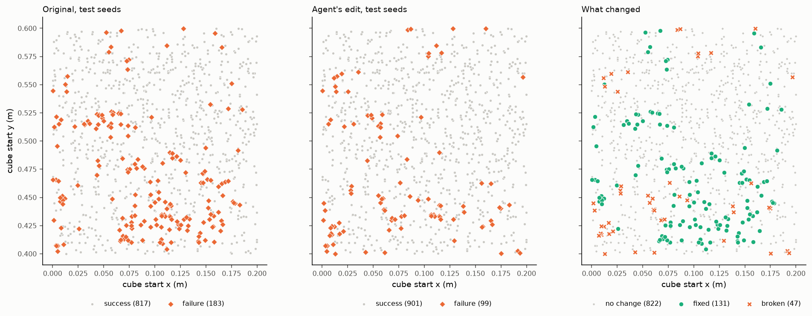
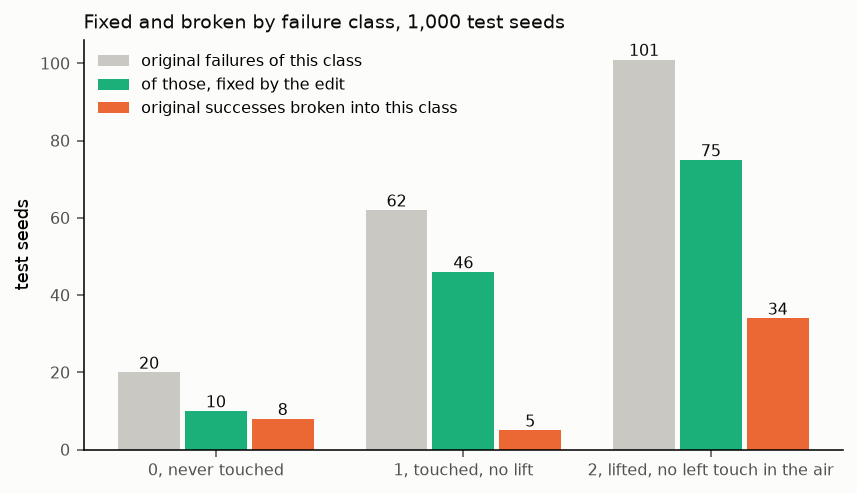
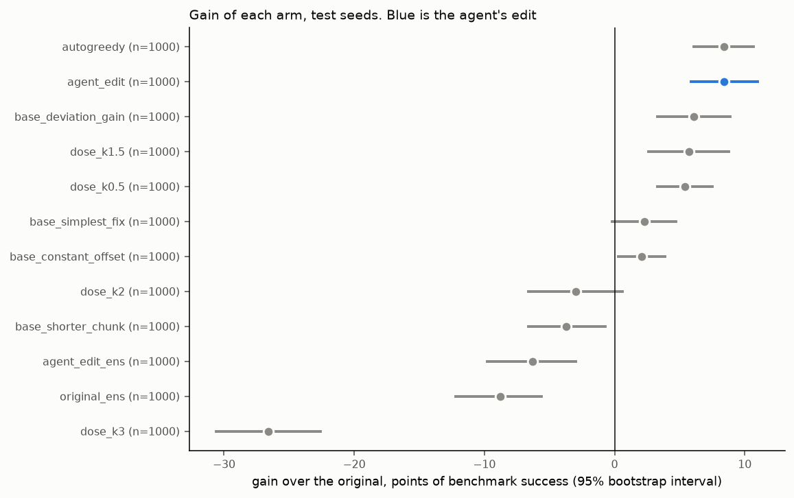
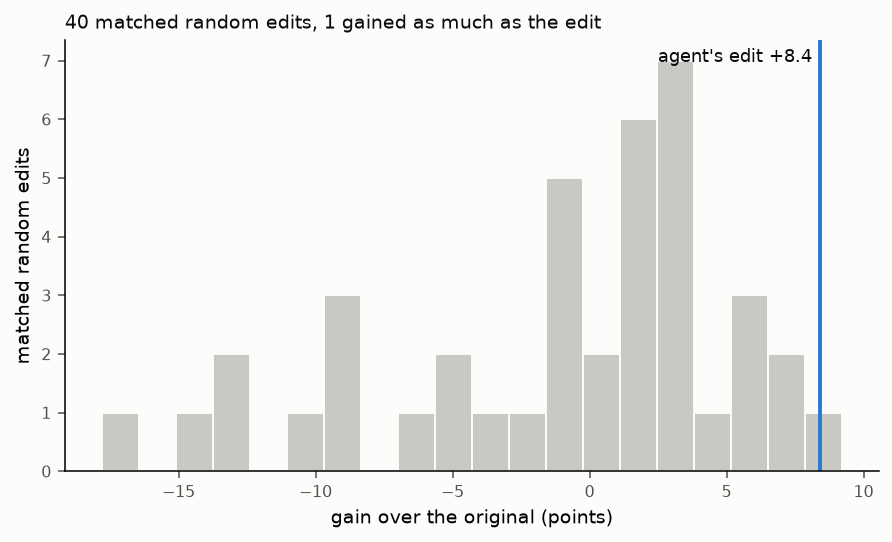
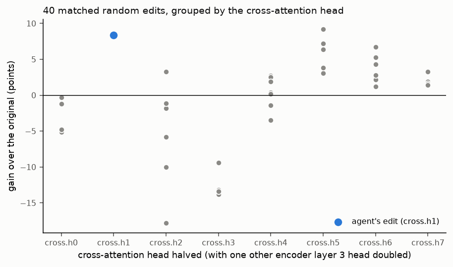
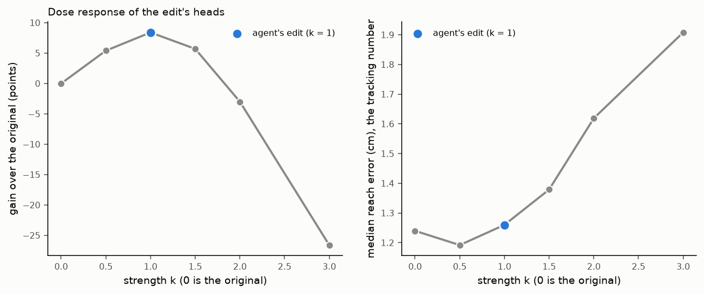

# Report, transfer_cube

The referee's block below is copied from `test/VERDICT.md` and is final. The rest of this file describes the per-seed files behind it and decides nothing. Sections marked *descriptive* were computed after the test was read. They carry no verdict.

<!-- referee-verdict-begin -->
## Referee verdict for transfer_cube

**Ending. Strong win**

| Item | Value |
|---|---|
| Test seeds | 1,000 seeds, 1711781023 to 1711782022, drawn from beacon round 34241540 after the freeze was public |
| Primary score | benchmark success |
| Original policy | 81.7% |
| Edited policy | 90.1% |
| Net gain | 8.4 points, 95% interval 5.9 to 10.9 |
| Seeds fixed and broken | 131 fixed, 47 broken |
| Exact McNemar p | 2.29e-10 |
| Share of failures removed | 45.9%, 95% interval 34.8% to 55.8% |
| Guard score, strict handover | 78.1% to 87.3%. A drop of up to 2.0 points is allowed. Passed |
| H2, matched random edits | 1 of 40 gained as much, and at most 1 may. Passed |
| H3, best simple baseline | deviation_gain at 6.1 points, against 8.4 for the edit on the same seeds. No baseline matched the edit |
| Auto-greedy edit, built with no LLM | 8.4 points. It matched the agent edit |
| Cross-check with LeRobot's own evaluator | original agreed on 100.0% of 357 episodes. agent_edit agreed on 100.0% of 357 episodes |
| Size of the edit | 65,536 weights, 0.191% of the weights that run at inference |
| Reviews by a separate session | Gate 1 passed review in round 2. Freeze request 1 passed review in round 2 |
| Freeze | tag freeze-transfer_cube-1, commit dd626ffe5163, rules from genesis-1 |
| Commitment | https://github.com/andrewheejay/act-weight-editing/releases/tag/freeze-transfer_cube-1, published 2026-11-24T13:36:24Z |

Why this ending.
- significant, beats the random edits, and no simple baseline matches it
- removes at least 25% of failures

<!-- referee-verdict-end -->

## What happened, in short

One pair of attention heads was rescaled (encoder layer 3 head 4 doubled, decoder cross-attention head 1 halved, 65,536 weights, 0.19% of those that run). On the 1,000 test seeds success rose from 81.7% to 90.1%: 131 seeds fixed, 47 broken. Design, validation and test gains were +10.6, +9.2 and +8.4 points, so they shrank a little at each step. Some shrinkage is expected after picking the best of many arms, and the validation to test difference is also within noise. The share of failures removed was 51.7% on validation and 45.9% on the test.

What this does not show is as important:

1. **The "special heads" claim passed at the edge.** H2 allows 1 of 40 random edits to gain as much. One did: random_00 (enc3.h1 doubled, cross.h5 halved) gained +9.2, more than the edit. Paired on the seeds the edit is 0.8 points behind it (95% interval -2.7 to +1.1, 45 seeds against 53), so the two are not distinguishable, and random_00 is the best of 40, so its own +9.2 is likely flattered. With one more such edit the ending would have been Partial. 22 of the 40 random edits had a positive gain, and 14 were positive with p below 0.05 (uncorrected). So scaling heads in these two blocks often helps, and the agent's choice is one of the better ones.
2. **The auto-greedy arm matched the edit exactly, 8.4 to 8.4 (and 9.2 to 9.2 on strict).** It is not an independent no-LLM result. Its two heads (enc0.h1 at 0, enc3.h4 at 2) equal the agent's own candidate r2, and the agent had seen r2's results before the script that returned it was committed (DEVIATIONS.md, 2026-11-24, and `relation_to_agent_candidates` in freeze/autogreedy.json). It shares enc3.h4 with the edit. Paired, 47 seeds go to each side.
3. **The written mechanism is not supported.** The hypothesis was that the edit makes the first reach land better. On the test seeds the median reach error went up slightly (1.24 to 1.26 cm, 1.20 to 1.28 on validation). Failures of the grasp kind and the others were fixed at similar rates (76 of 110 and 55 of 73). The head the hypothesis says carries the cube signal too weakly (enc3.h4) has almost none of it in the atlas (drop -0.001, rank 36 of 48). We report a score improvement with no accepted explanation.
4. **The strongest simple rival is closer than the headline suggests, especially on the guard score.** On benchmark success the edit leads the deviation gain by 2.3 points (95% interval +0.3 to +4.3, p 0.03 descriptive). On strict handover the lead is 0.4 points (p 0.79).

The exact claim of the result is a significant gain on unseen seeds in this one scene, with this one checkpoint, that meets the pre-set rules for H2 (39 of 40 random edits gained less) and H3 (every simple baseline gained less). Nothing here says why.

## Before and after maps

Orange diamonds are failures. The third panel shows the 131 fixed (green) and 47 broken (orange crosses). The edit clears much of the weak zone near x 0.08 to 0.16, y 0.40 to 0.48, and breaks seeds in several places, most visibly near the low-x edge.

| zone (defined before any edit unless marked) | n | original | edit | fixed | broke |
|---|---|---|---|---|---|
| hot block, inside | 154 | 54.5% | 87.0% | 56 | 6 |
| hot block, outside | 846 | 86.6% | 90.7% | 75 | 41 |
| low strip y < 0.44, inside | 193 | 64.2% | 76.7% | 45 | 21 |
| low strip y < 0.44, outside | 807 | 85.9% | 93.3% | 86 | 26 |
| low corner x < 0.06, y < 0.47 (defined after the validation map, so post hoc) | 100 | 81.0% | 74.0% | 11 | 18 |

The low corner got worse on validation (43 to 32 of 50 successes) and again here (81 to 74 of 100), the one post hoc prediction the test speaks to. On the test alone, 11 fixed against 18 broken gives a two-sided exact p of 0.26, so the test is consistent with a small loss there and does not establish it.

## Fixed and broken by failure class

| class | original | edit |
|---|---|---|
| 0, right gripper never touched the cube | 20 | 15 |
| 1, touched, not lifted | 62 | 14 |
| 2, lifted, no left touch in the air | 101 | 70 |
| 4a, touched in the air, no completed handover (benchmark success) | 36 | 28 |
| 4b, completed handover | 781 | 873 |

No failure class grew. Of the 183 original failures, the edit fixed 10 of 20 in class 0, 46 of 62 in class 1 and 75 of 101 in class 2. The 47 broken seeds became class 0 (8), class 1 (5) and class 2 (34). Grasp failures fell from 110 to 55 and strict success rose from 78.1% to 87.3% (146 fixed, 54 broken).

## Gain of every arm

| arm | success | gain (points) | 95% interval | fixed | broke | strict gain (points) |
|---|---|---|---|---|---|---|
| random_00 (best of 40 random edits) | 90.9% | +9.2 | +6.9 to +11.5 | 120 | 28 | +7.9 |
| agent's edit | 90.1% | +8.4 | +5.9 to +11.0 | 131 | 47 | +9.2 |
| auto-greedy | 90.1% | +8.4 | +6.1 to +10.7 | 113 | 29 | +9.2 |
| deviation gain 0.9, both arms, no grippers | 87.8% | +6.1 | +3.3 to +8.9 | 133 | 72 | +8.8 |
| dose k = 1.5 | 87.4% | +5.7 | +2.6 to +8.8 | 152 | 95 | +6.3 |
| dose k = 0.5 | 87.1% | +5.4 | +3.3 to +7.5 | 88 | 34 | +6.0 |
| simplest fix | 84.0% | +2.3 | -0.2 to +4.7 | 91 | 68 | +2.3 |
| constant offset | 83.8% | +2.1 | +0.3 to +3.9 | 53 | 32 | +2.6 |
| dose k = 2 | 78.7% | -3.0 | -6.6 to +0.6 | 146 | 176 | -5.2 |
| shorter chunk, 50 steps | 78.0% | -3.7 | -6.6 to -0.7 | 91 | 128 | -6.7 |
| edit with ensembling | 75.4% | -6.3 | -9.8 to -3.0 | 118 | 181 | -9.0 |
| original with ensembling | 72.9% | -8.8 | -12.2 to -5.6 | 104 | 192 | -12.0 |
| dose k = 3 | 55.1% | -26.6 | -30.6 to -22.6 | 111 | 377 | -33.2 |

These intervals are from the frozen analysis (bootstrap seed 0). The referee's interval for the edit, 5.9 to 10.9, is seeded from the beacon and is the one the verdict uses. The best 5 of 40 random edits span +6.4 to +9.2. Four points follow from this table and from `extra_tables.md`:

- The constant-offset winner sits at the smallest step of its grid (0.01), which the freeze already disclosed.
- Shorter chunks, ensembling and large doses hurt. Ensembling costs 8.8 points on the original and 14.7 on the edit relative to the edit without it. The edit gains 2.5 points over the original when both use ensembling (95% interval +0.1 to +5.0, p 0.06).
- Against the simple baselines the paired lead is 6.1 (simplest fix), 6.3 (constant offset), 12.1 (shorter chunk) and 17.2 (ensembling) points. Against the deviation gain it is 2.3 (63 seeds only the edit got, 40 only the gain).
- On strict handover the lead over the deviation gain is 0.4 points, inside its interval of -1.8 to +2.6.

## Random edits

40 of the 49 available matched pairs were run (same two blocks, same scales, other heads). Gains run from -17.8 to +9.2 with mean -1.1 and median +0.8. *Descriptive and post hoc.* The gain depends mostly on which cross-attention head is halved. Halving cross.h5 gave +3.1 to +9.2 in all 6 draws, cross.h6 +1.2 to +6.7 in all 6, and cross.h3 -9.3 to -13.8 in all 6. The choice of encoder head matters less. The edit's own cross.h1 was not among the random heads (that head is in the edit), and no other arm in the file isolates cross.h1 or enc3.h4 on the test, so the pair's parts cannot be separated here. On strict handover no random edit matched the edit's +9.2 (best +8.1, random_21).

## Dose response

| strength k | gain (points) | grasp failures | median reach error (cm) | median lateral command deviation (cm) |
|---|---|---|---|---|
| 0 (original) | 0.0 | 110 | 1.240 | 0.722 |
| 0.5 | +5.4 | 62 | 1.192 | 0.600 |
| 1 (the edit) | +8.4 | 55 | 1.260 | 0.547 |
| 1.5 | +5.7 | 92 | 1.379 | 0.653 |
| 2 | -3.0 | 131 | 1.619 | 0.911 |
| 3 | -26.6 | 223 | 1.908 | 1.071 |

The edit sits at the top of a hump. Because the edit turns one head up and the other down, the dial k scales each head's distance from 1. From k = 2 on cross.h1 is at 0, so k = 2 and k = 3 differ only in enc3.h4. The spec counts a number as a dial only if it moves the same way at every step. The tracking number (reach error) does not (1.240, 1.192, 1.260, 1.379, 1.619, 1.908), and neither does the lateral deviation, so by that rule the tracking number is not a dial and the mechanism it was meant to track is not confirmed. Because the dose arms are measured on the same seeds that show the best k, they give no new choice of k.

## Videos

`videos/` holds 8 side-by-side clips (original left, edit right) on **design** seeds, chosen by a fixed rule (rng 0, see `videos.py`): 2 fixed grasp failures, 2 fixed other failures, 2 seeds the edit broke, 1 both succeed, 1 both fail. They are illustrations from the design seeds, which were used to choose the edit, not test evidence. Test seeds are the referee's alone, so no clip was made from them. The 16 re-run rollouts match the earlier trajectory hashes on all 16. Index and provenance: `videos/index.json`, `video_runs.jsonl`.

## Limits

- One scene, one cube, one checkpoint and one simulator. The insertion checkpoint (H4) is not part of this verdict.
- The H2 pass has no margin, and the rule is about how many random edits match the score, not how close they are.
- The edit was chosen among 8 candidates checked on validation seeds, after the design seeds had been used to choose them. r6 and s1 were statistically tied with r4 on validation. The design numbers of r4 and the baseline were known when the choice rule was fixed, and the rule was not blind to the design results. DEVIATIONS.md lists this.
- The low corner is worse on validation and test. A deployment that starts cubes there would lose.
- **The gain does not carry outside the conditions it was chosen on** (Stage 6 stress checks, `../stage6/stress.md`, explicit poses, reported and not judged). In the 3 cm band outside the square the edit is much worse than the original, 26.1% against 39.7% (-13.6 points, 95% interval -16.4 to -10.9, 42 fixed, 178 broken, n 1,000). With the cube turned by 15 degrees the gain is +2.6 (-1.8 to +7.0), and by 30 degrees it is -3.2 (-7.6 to +1.2), against +8.6 (+5.0 to +12.2) on the same 500 positions unrotated. Both policies get worse as the cube turns. The unrotated control was added by the agent.
- The referee's stock cross-check agreed on 100% of 357 episodes for both arms, so the harness and LeRobot's evaluator agree.

## Files behind this report

`python experiments/transfer_cube/freeze/analysis.py --mode test` writes `report/analysis/`. `python experiments/transfer_cube/report/extra_tables.py` writes `report/extra.json`, `extra_tables.md` and the last two charts. `python experiments/transfer_cube/report/videos.py` makes the clips (16 agent-budget rollouts on design seeds). `python experiments/transfer_cube/report/write_report.py` builds this file from `body.md` and the verdict. The sources are `test/arms/*.jsonl`, `test/verdict.json` and `freeze/`.
