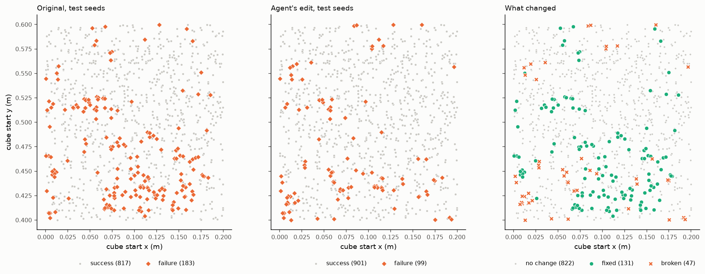
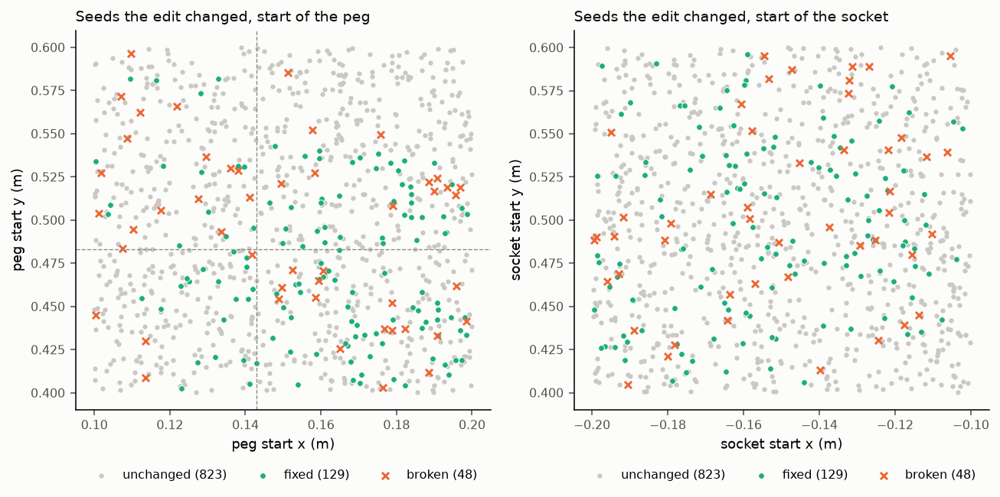

# Editing a few attention heads in a robot policy: a pre-registered test on two ACT checkpoints

*Draft for Andrew to edit before publishing. Every number below comes from a file in this repo, named next to it. Build: `python publish/write_post.py`.*

We took two public ACT policies from LeRobot, trained for the ALOHA simulation tasks, and asked one question. Can a Claude Code agent find a small weight edit, made only by rescaling attention heads, with no gradients and no training, that makes the policy succeed more often on start positions nobody has seen? The plan, the seed sets, the budgets and the pass rules were written down and tagged (`genesis-1`) before the first rollout. A scripted referee with no language model checked each gate. It drew the test seeds from a public randomness beacon only after each edit was frozen and published, then ran the test itself.

**Both tasks ended in a win, one strong and one modest.** On transfer cube, rescaling two heads (65,536 weights) raised benchmark success from 81.7% to 90.1% on 1,000 held-out seeds. On insertion, rescaling three heads (98,304 weights) raised strict success from 11.2% to 19.3%. But it removed only 9.1% of the failures, and the agent had already frozen that edit as a miss on validation. On neither task did the agent's written explanation of *why* the edit works survive its own pre-set test.

## Limits, up front

These come from the plan (SPEC.md) and hold for everything below.

- One scene per task, and start positions from one fixed region (one 20 cm square for the cube; a 10 by 20 cm box each for the peg and the socket, `awe/stage1.py` INS_BOX).
- Simulation only. On a real arm, an edited policy needs joint-limit and speed checks before it runs.
- One trained checkpoint per task, so we cannot say how this varies across training runs.
- One agent model (Claude Opus 5.5), and one run. The optional extra runs from fresh sessions did not happen.
- We show what the edited parts do. Why the policy computes it that way is a separate question, and our own attempts at an answer failed (below).
- The plan gives the agent far more structure than earlier posts did. So the result says more about weight editing than about how much an agent can do alone.
- No person checked the diagnosis or the freeze before the test. The scripted referee and a second Claude session (the reviewer) did. Their records are in `reviews/` and `experiments/*/freeze/`.

## The headline

| | Transfer cube | Insertion |
|---|---|---|
| Primary score (chosen in Stage 1) | benchmark success | strict insertion |
| Original, 1,000 test seeds | 81.7% | 11.2% |
| Edited | 90.1% | 19.3% |
| Net gain (95% interval) | +8.4 points (5.9 to 10.9) | +8.1 points (5.5 to 10.7) |
| Seeds fixed / broken | 131 / 47 | 129 / 48 |
| Share of failures removed | 45.9% | 9.1% |
| Guard score | strict handover 78.1% to 87.3% | benchmark 19.7% to 30.4% |
| Random edits of the same shape that gained as much | 1 of 40 (at most 1 allowed) | 0 of 40 |
| Best simple baseline on the same seeds | deviation gain, +6.1 | constant offset, +3.6 |
| The edit | encoder layer 3 head 4 doubled, cross-attention head 1 halved | cross-attention head 0 off, encoder layer 3 head 3 off, encoder layer 0 head 6 doubled |
| Weights changed | 0.191% of those that run | 0.287% |
| Referee's ending | **strong win** | **modest win** |

Sources: `experiments/<task>/test/verdict.json` and `VERDICT.md`. The two verdict blocks are copied unchanged at the end of this post.

The pre-registered endings were strong win, modest win, partial and null. A strong win needs a significant gain that beats the random edits and every simple baseline, and removes at least a quarter of the failures. Insertion met everything but the last condition, so the referee called it modest.

## What the agent did

The protocol has the same stages for each task. Seeds are split into reproduction (1000 to 1499), design (20000 to 20999, used freely), validation (30000 to 30499, at most 10 candidates per task, ever) and test (drawn by the referee above 1,000,000,000).

1. **Reproduce.** Our harness gave 81.8% on the published evaluation seeds for transfer cube, against the published 83.0%. For insertion it gave 18.2%, against 20.6% on the model card. LeRobot's own evaluator agreed with our harness on every episode the referee cross-checked (357 and 255 test episodes).
2. **Diagnose.** The agent ran 1,000 design seeds and a 41 by 41 grid of start positions, and sorted the failures. On transfer cube, two thirds of failures were grasp failures, where the cube is never lifted. On insertion the largest group (40.5% of design seeds) had the peg meet the socket in the air without ever reaching the pin.
3. **Map the heads.** All 48 heads were scaled to 0 and to 2, open loop on recorded states and closed loop on 500 design seeds. The result is the head atlas (`publish/atlas/index.html`).
4. **Search, validate, freeze.** The agent combined promising heads on design seeds and checked 8 candidates per task on validation seeds. It froze one by a rule written before the validation results. On transfer cube the frozen edit removed 51.7% of validation failures and passed. On insertion the best candidate removed 8.6%, short of the 25% rule. The agent froze it anyway under the plan's stop rule, and it said so in the freeze (`experiments/insertion/freeze/edit.json`, `stop_rule_used: true`).
5. **Test.** The referee tagged each freeze, published the commit as a GitHub release, drew 1,000 seeds from a later drand beacon round, and ran every arm.

The gain shrank a little at each step, as it should after picking the best of many arms. On transfer cube it went +10.6 (design), +9.2 (validation), +8.4 (test). On insertion it went +10.6, +7.8, +8.1.

Budgets used: transfer cube 95,073 agent rollouts of 100,000, 46,800 baseline and 8,550 auto-greedy. Insertion: 93,400, 46,812 and 8,550. 8 of 10 validation checks per task. No rollout touched a test seed (`python -m referee.recompute ledger`).

## The maps

On transfer cube the original's failures cluster in a block near x 0.08 to 0.16 m, y 0.40 to 0.48 m. The edit clears much of it: success inside that block rose from 54.5% to 87.0%, and outside it from 86.6% to 90.7%. One corner got worse. At low x and low y success fell from 81% to 74% (100 seeds, 11 fixed and 18 broken, p 0.26). That zone was drawn after we saw the validation map, so it is post hoc, and the test is consistent with a small loss there without establishing it.

On insertion the gain is spread out. It does *not* repair the weak zone the diagnosis pointed to. Where the original's peg-tip offset was largest, the edit gains 4 to 5 points. Elsewhere it gains 11 to 12. It mostly lifts placements where the original already did better.

## What it does not show

**Why it works.** Each frozen edit came with a written hypothesis and a tracking number fixed in advance. On transfer cube the hypothesis was that the edit makes the first reach land closer. Median reach error went slightly up instead (1.24 to 1.26 cm), and the head the story relied on (encoder 3, head 4) loses almost no cube-position signal when removed. On insertion the hypothesis was that the two heads turned off slow the approach. The tracking number, the peg-tip offset before contact, got worse (1.52 to 1.62 cm). Timing measures picked after the test do move the predicted way. The first peg-socket contact came earlier (median step 300 to 289), and the number of episodes reaching the pin rose from 197 to 304. Most of the insertion gain is more episodes reaching the pin at all, not better insertion once there. Those measures were chosen after the fact, so they are a lead for later work and not a finding. We report two score improvements with no accepted explanation.

**That these heads are special.** On transfer cube one of the 40 random edits (other heads, same blocks, same scales) gained +9.2, more than the edit, and 22 of 40 had a positive gain. The rule allows one such edit, so H2 passed with no margin. A second one would have made the ending partial. On insertion the random edits mostly hurt (mean -3.35, best +1.5), so there the choice of heads mattered.

**That an LLM was needed.** The plan includes an auto-greedy script that searches the sweep table with no reasoning. On both tasks its output turned out to be one of the agent's own candidates, which the agent had already seen. On transfer cube it equals candidate r2 and matched the edit exactly (+8.4). On insertion it equals c06, the frozen edit minus its third head, and gained +7.4. The referee's rule calls that "did not match" because the gain is smaller. Paired on the same seeds, the gap is +0.7 points (-1.6 to +3.0, p 0.6), so the third head adds nothing measurable. Neither arm is an independent no-LLM result (DEVIATIONS.md, 2026-11-24 and 2026-11-25).

**That it carries outside the square.** These stress checks were on transfer cube only, reported and not judged (`experiments/transfer_cube/stage6/stress.md`). In a 3 cm band just outside the start square, the edit is much *worse* than the original (26.1% against 39.7%, -13.6 points). With the cube turned 15 degrees the gain is +2.6, and at 30 degrees it is -3.2, against +8.6 on the same positions unrotated. The edit is tuned to the conditions it was chosen on.

**That a simple fix could not get close.** Every baseline lost to the edit on the test seeds. On transfer cube the deviation gain (an action-level rule, a' = mean + 0.9 (a - mean)) came within 2.3 points on benchmark success and 0.4 points on strict handover. Shorter chunks and temporal ensembling hurt on both tasks. On insertion, ensembling dropped strict success from 11.2% to 7.2% while raising benchmark success a little.

## Does the benchmark overstate success?

A little on transfer cube, and a lot on insertion. The stock check fires at a single step: on transfer cube when the left gripper touches the cube while it is off the table (the right gripper never has to let go), on insertion when the peg touches the pin. Our strict scores ask for 25 steps in a row: the left gripper holding the cube off the table with the right gripper off it, or the peg on the pin with each gripper holding its object and both objects off the table. On the test seeds the original policy scores 81.7% benchmark against 78.1% strict on transfer cube, and 19.7% against 11.2% on insertion. Separately, the hub's per-episode `eval_info.json` for the insertion checkpoint is a byte-for-byte copy of the transfer-cube file (`experiments/insertion/stage0/published_note.md`). No published per-seed result exists for insertion.

## The head atlas

`publish/atlas/index.html` is one page covering all 48 heads of both checkpoints. For each head it shows how much the action chunk moves when the head is removed or doubled, how much object-position signal it carries, which joints it moves, and what a closed-loop sweep on 500 design seeds did to the score. It comes from design seeds and recorded states, so it is a screen and not evidence. Its p values are uncorrected over 96 arms. A few heads dominate. On transfer cube, removing cross-attention head 3 or head 2 nearly destroys the policy (-78 and -75 points over 500 design seeds), and encoder layer 0 head 0 moves the chunk most open loop. On insertion, single heads move the score much less, and the largest single gain is removing cross-attention head 0 (+8.0 strict points), which became part of the frozen edit. Turning one cross-attention head down was part of both frozen edits.

## Where to check us

- Plan and rules: `SPEC.md`, `referee/RULES.md`, tag `genesis-1`. Departures, dated: `DEVIATIONS.md`.
- Every rollout: `ledger/`. Per-seed test outcomes for every arm: `experiments/<task>/test/arms/`.
- The seed draws: `python -m referee.verify_draw experiments/<task>/test`.
- Full reports: `experiments/transfer_cube/report/report.md`, `experiments/insertion/report/report.md`.
- Lab notebook, append-only: `PROGRESS.md`. Reviews and replies: `reviews/`.

## Referee verdicts, copied unchanged

{{VERDICT:transfer_cube}}

{{VERDICT:insertion}}
